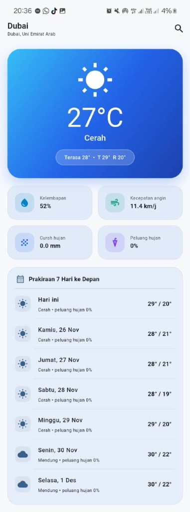
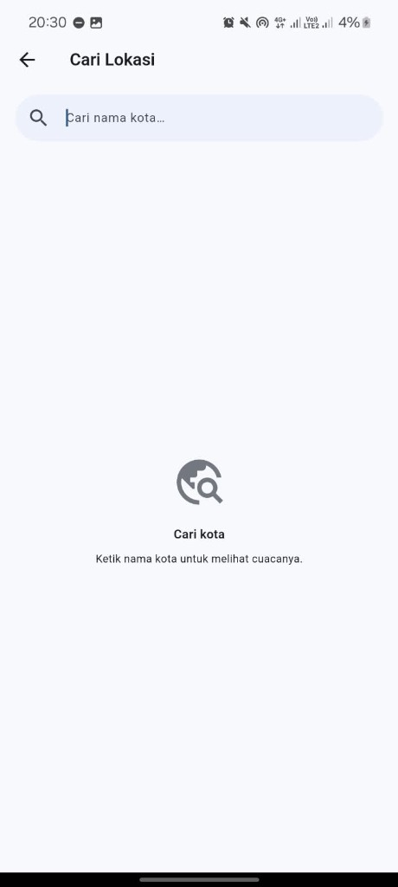
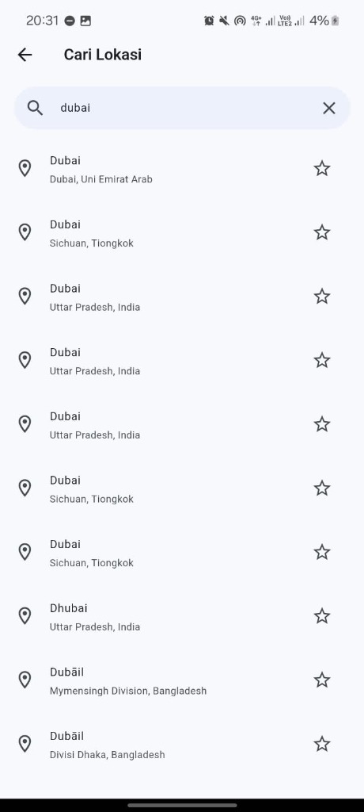
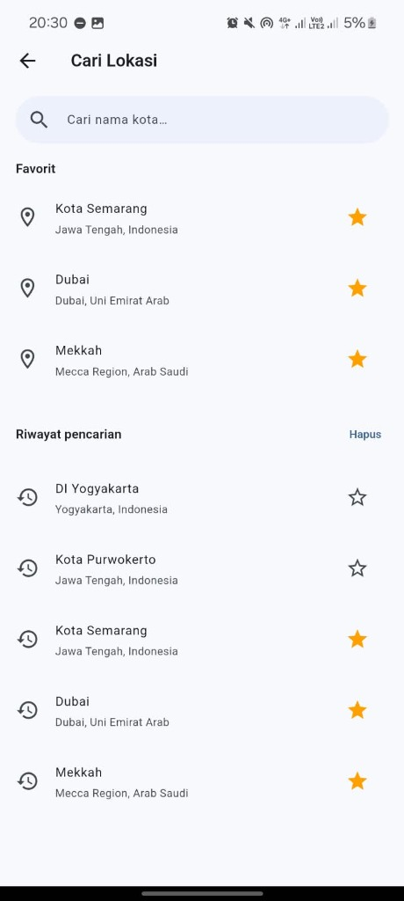
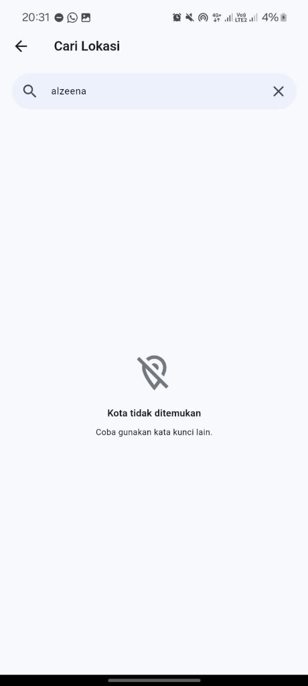
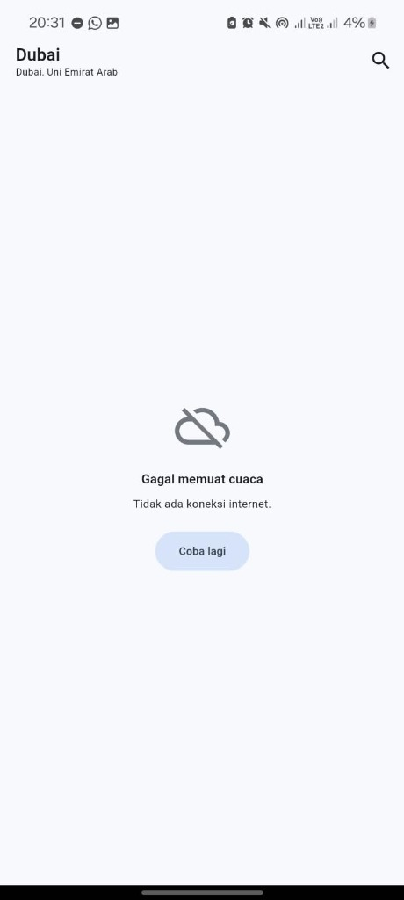

# Aplikasi Cuaca (Responsi Praktikum Pemrograman Mobile)

Aplikasi pemantau cuaca real-time dan prakiraan harian berbasis Flutter & Dart. Proyek ini dibangun untuk memenuhi penugasan Responsi Pemrograman Mobile dengan arsitektur Model-View-ViewModel (MVVM), state management Provider, konsumsi REST API Open-Meteo, serta penyimpanan lokal menggunakan SharedPreferences.

---

## 📌 Identitas

| Komponen | Data Mahasiswa |
| :--- | :--- |
| **Nama Lengkap** | Cut Alzeena Rency Fadania |
| **NIM** | H1D024037 |
| **Shift Awal** | A |
| **Shift Baru** | E |
| **Video Penjelasan** | [Link YouTube](https://youtu.be/GilFlPKkEAE) |

---

## 📸 Dokumentasi Tampilan Aplikasi

| Home Screen | Cari Lokasi | Hasil Pencarian |
| :---: | :---: | :---: |
|  |  |  |

| Lokasi Favorit & Riwayat | Pencarian Tidak Ditemukan | Koneksi Terputus (Offline) |
| :---: | :---: | :---: |
|  |  |  |

---

## ✨ Fitur Utama

- **Cuaca Real-Time:** Menampilkan temperatur aktual, suhu yang dirasakan, kelembapan udara, kecepatan angin, curah hujan, serta kondisi cuaca (kode WMO terjemahan Indonesia).
- **Prakiraan 7 Hari:** Rincian suhu maksimum, minimum, dan peluang presipitasi harian selama seminggu.
- **Pencarian Kota Pintar:** Pencarian lokasi via Geocoding API dengan jeda *debounce* 500 ms untuk efisiensi request.
- **Penyimpanan Lokal:** Menyimpan kota favorit, riwayat 10 pencarian terakhir, dan lokasi aktif terakhir.
- **Penanganan State Lengkap:** Mendukung status *loading*, *empty state* (kota tidak ditemukan), dan *error handling* (offline) dilengkapi tombol coba lagi.
- **Pull-to-Refresh:** Pembaruan data cuaca instan dengan menarik layar ke bawah.

---

## 🏗️ Penerapan Arsitektur MVVM

Aplikasi memisahkan tanggung jawab kode ke dalam tiga lapisan utama:

```
┌─────────────────────────────────────────────────────────────┐
│                         VIEW (UI)                           │
│       HomeScreen, SearchScreen, & Komponen Widget           │
└──────────────────────────────┬──────────────────────────────┘
                               │ Listen State & Kirim Event
                               ▼
┌─────────────────────────────────────────────────────────────┐
│                      VIEWMODEL (STATE)                      │
│        WeatherViewModel (Cuaca) & LocationViewModel         │
└──────────────────────────────┬──────────────────────────────┘
                               │ Request Data
                               ▼
┌─────────────────────────────────────────────────────────────┐
│                      MODEL & SERVICES                       │
│    WeatherService (REST API) & LocalStorageService (Cache)  │
└─────────────────────────────────────────────────────────────┘
```

- **Model (`lib/models/`):** Kelas data `WeatherModel` dan `LocationModel` yang mengonversi respons JSON API menjadi objek Dart via `.fromJson()`.
- **Service (`lib/services/`):** `WeatherService` menangani komunikasi HTTP GET ke Open-Meteo, sedangkan `LocalStorageService` mengelola persistensi SharedPreferences.
- **ViewModel (`lib/viewmodels/`):** Turunan `ChangeNotifier` (`WeatherViewModel` dan `LocationViewModel`) yang mengelola state, menjalankan logika bisnis, dan memanggil `notifyListeners()` saat data berubah.
- **View (`lib/views/`):** Antarmuka pengguna murni yang mendengarkan state via `context.watch<T>()` tanpa berinteraksi langsung dengan API atau penyimpanan.

---

## 🌐 Integrasi REST API (Open-Meteo)

Data diambil secara langsung dari endpoint Open-Meteo (metode HTTP GET) tanpa API key:
- **Geocoding API:** `https://geocoding-api.open-meteo.com/v1/search` (konversi nama kota ke koordinat lintang & bujur).
- **Weather Forecast API:** `https://api.open-meteo.com/v1/forecast` (mengambil parameter cuaca terkini dan harian).

### Parameter API dan Pemetaan Field

| Data Aplikasi | Field API Open-Meteo | Keterangan |
| :--- | :--- | :--- |
| **Suhu Saat Ini** | `current.temperature_2m` | Temperatur aktual (°C) |
| **Kelembapan** | `current.relative_humidity_2m` | Kelembapan relatif (%) |
| **Suhu yang Dirasakan** | `current.apparent_temperature` | Estimasi suhu terasa (°C) |
| **Curah Hujan** | `current.precipitation` | Debit presipitasi (mm) |
| **Kondisi Cuaca** | `current.weather_code` | Kode WMO standar internasional |
| **Kecepatan Angin** | `current.wind_speed_10m` | Kecepatan angin (km/jam) |
| **Suhu Maksimum Harian** | `daily.temperature_2m_max` | Suhu tertinggi harian |
| **Suhu Minimum Harian** | `daily.temperature_2m_min` | Suhu terendah harian |
| **Peluang Hujan Maksimum**| `daily.precipitation_probability_max` | Potensi presipitasi harian (%) |

---

## 💾 Penyimpanan Lokal (SharedPreferences)

Menggunakan package `shared_preferences` untuk menyimpan data dalam format JSON:
- **`favorites`:** Daftar lokasi favorit yang ditandai bintang.
- **`search_history`:** Riwayat 10 kota terakhir yang pernah dicari.
- **`last_location`:** Lokasi terakhir yang dibuka agar langsung dimuat otomatis saat aplikasi kembali dijalankan.

---

## 📁 Struktur Direktori Proyek

```
lib/
├── main.dart                       # Titik masuk aplikasi & konfigurasi Provider
├── core/
│   ├── theme/app_theme.dart        # Konfigurasi ThemeData & tipografi Material 3
│   └── utils/weather_code.dart     # Pemetaan kode WMO ke teks & ikon cuaca
├── models/
│   ├── location_model.dart         # Model lokasi dan koordinat
│   └── weather_model.dart          # Model cuaca terkini dan prakiraan
├── services/
│   ├── local_storage_service.dart  # Layanan SharedPreferences
│   └── weather_service.dart        # Layanan HTTP client Open-Meteo
├── viewmodels/
│   ├── location_viewmodel.dart     # Pengelola state pencarian & favorit
│   └── weather_viewmodel.dart      # Pengelola state cuaca lokasi aktif
└── views/
    ├── home_screen.dart            # Layar utama cuaca & prakiraan
    ├── search_screen.dart          # Layar pencarian & daftar favorit
    └── widgets/                    # Komponen modular antarmuka
```

---

## 🚀 Panduan Menjalankan Aplikasi

1. **Clone repositori:**
   ```bash
   git clone https://github.com/alzeecyy/Responsi2_PemogramanMobile_Cuaca_H1D024037.git
   cd Responsi2_PemogramanMobile_Cuaca_H1D024037
   ```
2. **Pasang dependensi:**
   ```bash
   flutter pub get
   ```
3. **Jalankan unit test:**
   ```bash
   flutter test
   ```
4. **Jalankan aplikasi:**
   ```bash
   flutter run
   ```
   *(Atau jalankan di browser: `flutter run -d chrome`)*
